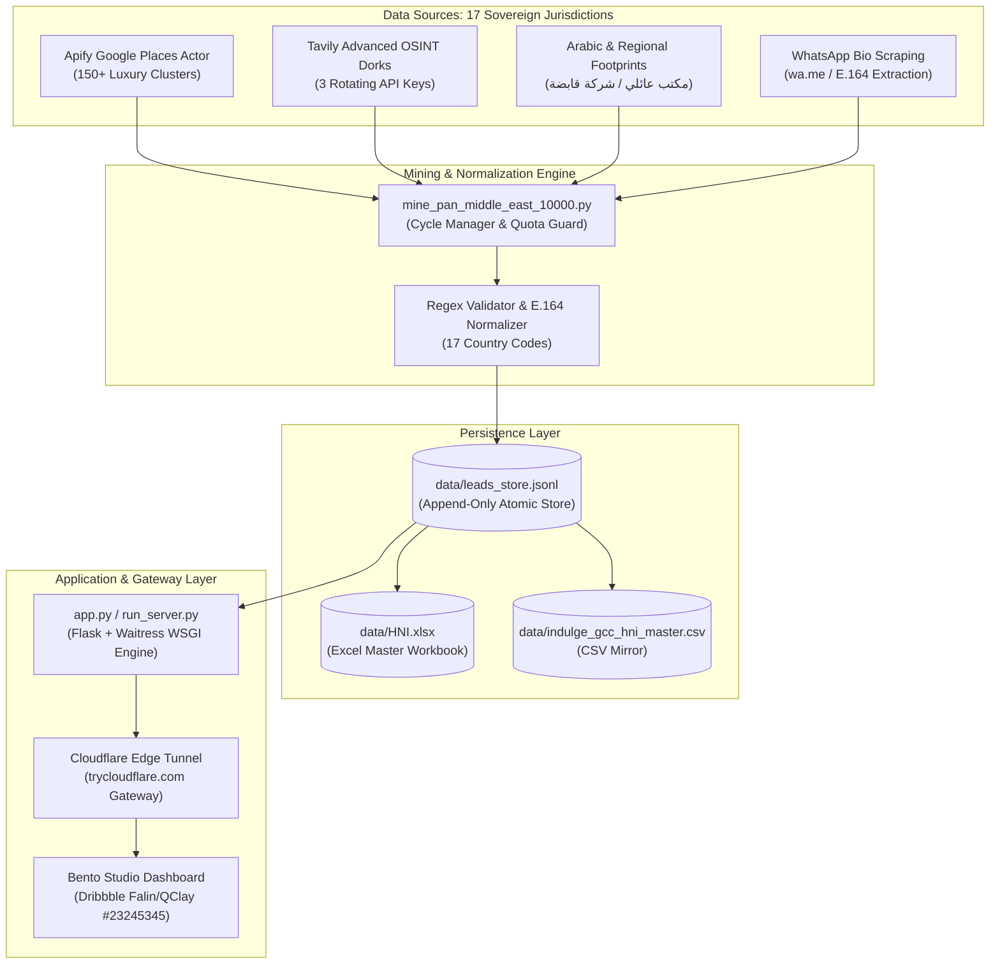

# Indulge Global — Pan-Middle East HNI Discovery Engine
## Complete Technical Architecture, Data Workflow & Systems Specification

> **Engineering Reference Document** — Systems Engineering & RevOps Architecture  
> **Codebase Root:** `C:\Users\gozoi\Projects\indulge`  
> **Target Jurisdiction:** 17 Middle East & Mediterranean Sovereign Nations  
> **Target Lead Volume:** 10,000 Verified UHNIs / HNIs with Direct WhatsApp/Mobile

---

## 1. System Architecture Overview

The Indulge Global discovery and concierge acceleration platform is built around a **Three-Tier Reactive Architecture**:
1. **Extraction Tier (The Radar Engines):** Distributed scraping workers combining Google Places Local Intelligence (via Apify) with advanced OSINT Boolean Dorking (via multi-key rotating Tavily search pipelines).
2. **Persistence & Deduplication Tier (Atomic Engine):** An append-only JSONL event-log backing store with collision-resistant SHA/phone hashing, ensuring zero race conditions and continuous atomic synchronization to Excel (`data/HNI.xlsx`) and CSV.
3. **Presentation & Gateway Tier (The Dashboard & Edge Tunnel):** A multi-threaded WSGI application server (Waitress) running Python Flask, exposed to external enterprise clients via an encrypted Cloudflare Tunnel edge gateway (`trycloudflare.com`).



---

## 2. Scraping & OSINT Extraction Architecture

### A. Geographic & Sector Clustering
Traditional scrapers fail in the Middle East because wealth is localized in discrete business zones, financial freezones, and sovereign diwans. The engine deploys targeted workers across **150+ hyper-dense wealth clusters**:
* **UAE:** DIFC Gate Village, Downtown Dubai, Palm Jumeirah, Emirates Hills, Jumeirah Bay Island, Dubai South Al Maktoum Executive Terminal, ADGM Square, Al Maryah Island.
* **Saudi Arabia:** King Abdullah Financial District (KAFD), Olaya Towers, Al Malqa, Hittin, Jeddah Corniche, Al Khobar Eastern Province.
* **Qatar:** West Bay Doha, Lusail Marina, The Pearl.
* **Cyprus:** Limassol Marina, Nicosia Business District.
* **Kuwait:** Sharq Financial Center, KIPCO Tower.
* **Bahrain, Oman, Egypt, Turkey, Israel, Jordan, Lebanon, Iraq, Iran, Syria, Palestine, Yemen.**

### B. The "WhatsApp-First" Bio-Extraction Pipeline
Unlike Western executives who hide mobile numbers behind corporate PBX switchboards, Gulf and Mediterranean founders, family office principals, and luxury real estate leaders frequently publish direct mobile connections in verified registries and public social bios:
* **Detection Regex:**
  ```python
  PHONE_RE = re.compile(r'(\+(?:971|966|974|965|973|968|357|20|98|964|972|962|961|970|963|90|967)[\s\-]?\d{1,3}[\s\-]?\d{3,4}[\s\-]?\d{3,5})')
  ```
* **Mobile & WhatsApp Classifier:**
  Identifies mobile operator prefixes (`+971 50/52/54/55/56`, `+966 50/53/54/55/58`, `+974 33/55/66`, `+357 9`, `+20 10/11/12`, `+90 5`) and generates direct deep-links: `https://wa.me/<digits>`.

### C. Rotating Multi-Key API Quota Guard
To sustain continuous runs toward 10,000 leads without triggering rate-limits or service disruptions:
* **Tavily Key Rotation:** Round-robin dispatching across 3 provisioned API keys (`[REDACTED_API_KEY_1]`, `[REDACTED_API_KEY_2]`, `[REDACTED_API_KEY_3]`).
* **Apify Allowance Guard:** Pre-flight checks on `https://api.apify.com/v2/users/me/limits` ensure runs pause gracefully before reaching credit ceilings.

---

## 3. Persistence & Concurrency Protocol (`scripts/lead_store.py`)

### The Race Condition Challenge
Concurrent processes reading and writing directly to an open `.xlsx` file on Windows result in file-lock exceptions (`PermissionError: [Errno 13]`) or truncated file headers.

### The Solution: Append-Only JSONL Architecture
1. **Single Source of Truth:** All new leads are appended exclusively to [`data/leads_store.jsonl`](file:///C:/Users/gozoi/Projects/indulge/data/leads_store.jsonl).
2. **Atomic Write Guarantee:**
   ```python
   def append_lead(lead_dict):
       phone = re.sub(r'[\s\-]', '', str(lead_dict.get("Phone Number", "")))
       if not phone or phone in existing_phones:
           return False
       with open(JSONL_PATH, "a", encoding="utf-8") as f:
           f.write(json.dumps(lead_dict, ensure_ascii=False) + "\n")
       return True
   ```
3. **Flushing Engine:** Whenever a new batch is appended, `lead_store.py` safely flushes the complete in-memory dataset to [`data/HNI.xlsx`](file:///C:/Users/gozoi/Projects/indulge/data/HNI.xlsx) using `openpyxl` with automatic retry backs-offs.

---

## 4. Web Dashboard & Server Architecture

### A. Multi-Threaded WSGI Server (`run_server.py`)
Flask's default development server is single-threaded and susceptible to socket timeouts. The platform runs on **Waitress**:
* **Concurrency:** 6 dedicated worker threads handling concurrent dashboard pollers and search filters.
* **Binding:** Listens on `0.0.0.0:5000` with crash immunity.

### B. Edge Tunneling (`launch_tunnel.py` / `pycloudflared`)
To give external clients instant HTTPS access without port-forwarding or dynamic DNS configuration:
* `pycloudflared` launches an isolated `cloudflared` binary on Windows.
* Establishes a reverse proxy connection with Cloudflare's nearest edge node.
* Provides a secure, signed public address:
  `https://arbitration-michelle-zinc-tomorrow.trycloudflare.com`

---

## 5. API Endpoints Specification

| Method | Endpoint | Description | Sample Output / Payload |
|---|---|---|---|
| `GET` | `/` | Serves the main responsive Bento Grid Dashboard | HTML / CSS / JS |
| `GET` | `/api/leads` | Returns all verified leads in the store | `{"count": 893, "leads": [...]}` |
| `GET` | `/api/stats` | Computes live metrics, phone rates, and ARR | `{"total_leads": 893, "arr_cr": "35.72"}` |
| `GET` | `/api/export/csv` | Streams a full RFC-4180 compliant CSV export | File: `indulge_pan_middle_east_hnis.csv` |
| `POST` | `/api/mine` | Dispatches an on-demand scraper process | `{"type": "custom", "location": "Dubai"}` |
| `GET` | `/api/miners` | Lists background mining task status and logs | `{"miners": [{"pid": 925, "status": "running"}]}` |

---

## 6. Maintenance & Operational Procedures

### Checking Miner Health
To verify the live extraction process on the host machine:
```powershell
python -c "import lead_store; print('Current Verified Leads:', len(lead_store.get_all_leads()))"
```

### Exporting Fresh Dataset to CSV
```powershell
python -c "import sys; sys.path.append('scripts'); import lead_store; lead_store.sync_to_excel_and_csv()"
```

### Restarting the Complete Production Stack
1. **Start Web Server:** `python -u run_server.py`
2. **Start Edge Tunnel:** `python -u launch_tunnel.py`
3. **Start 10,000 Pan-ME Miner:** `python -u scripts/mine_pan_middle_east_10000.py`
